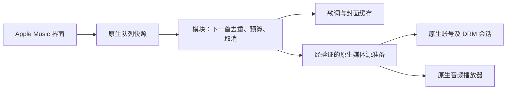

# 2026-11 上游与 fork 合并记录

目标版本：澜音 LyricWave 1.0.0-beta.9（129）。保留安装包身份、固定签名与既有配置键。

## 已合并

- 上游 `Zennmn/AM-plus-plus` 至 `388164c`（1.6.9）：Miuix 设置导航、平板分类与页面转场、歌词列表和编辑器整理。分享、HDR、播放诊断及 AI 活动/缓存操作已接回新界面。
- 本仓库至 `09c0d26`：版本 API、附件反代、下载页、完整附件 CDN 缓存及站点发现信息的最新改动。
- `Havenmab/AM-plus-plus`：选择移植 `a7a68a88`、`35fdebcc`、`2073e4e2`。新增公共镜像回退、可选自建源、AM-Lyrics 索引磁盘缓存与条件刷新；自动读取、手动导入和更新统一使用镜像地址。
- 镜像迁移保留澜音的歌词源顺序、原生歌词优先、逐字校验、手动编辑保护和 AI 缓存匹配条件。缓存刷新在后台按访问触发，不在创建播放器时预取；运行时关闭时释放后台线程。

## 检查范围与排除项

检查了另外 14 个公开 fork 的默认分支及现存功能分支。`loocul`、`MiseCan`、`dingxionghui`、`a23bc`、`UltraAce258`、`tcrrry`、`huang6668`、`FrancoGiudans`、`ITManCHINA`、`cdzwb1017` 的旧主分支均在上游历史内；没有重复覆盖当前实现。

- 按用户要求，**不合入 wakin721 的 USB 独占音频**，不新增其驱动、权限、服务或 PCM 输出链路。
- Kifranei 的独立分支主要针对 1609/1611 的旧玻璃菜单和旧适配。没有用它们覆盖目前已核验的 1614 profile 或玻璃实现。
- Nonnika 的独立通知/岛屿界面、其他 fork 的旧编辑器替代实现没有直接叠加到新设置导航。
- Havenmab 的整套地区重写、多平台在线补全及原生发音 overlay 不在本次移植内：其源选择模型和本分支可配置顺序、AI 缓存及精确宿主契约不同。没有整仓覆盖这些接口。

## 本次问题状态

- 分享封面：按分享曲目 ID 查询 Apple 公开封面，原地区为空时以相同 ID 查询美区；传入网易云原生 `GeneralResource.setCover`。查询完成前等待；失败时明确提示无封面。仍需实体设备验证朋友圈接收结果。
- 播放卡住：补全 DRM、音频渲染器、原生运行时与远程错误的分类、异常类名链和原生整数错误码；取消旧恢复任务。用户最终描述为“播放一段时间后当前曲目偶发持续加载，拖动仅响一下或无声，切歌恢复”。根因与声音恢复尚未在实体设备确认，没有将其宣称为已修复。
- 检测更新：在设置首页和高级设置手动查询公开版本 API，并读取该发布的构建元数据；按整数 versionCode 比较，禁止从 tag 猜测版本先后。提供附件反代、GitHub 原始下载与发布页。

## beta.10 后续更新

- 默认启用前台自动检测（成功 6 小时、失败 15 分钟间隔），可关闭；保留手动检测与磁盘缓存。
- 内建下载页使用最多 4 段下载，严格校验 Range；不支持或分段失败时改为单流。支持进度、取消、旋转保留和用户主动选择 GitHub 原始来源。完整 SHA-256、实际 APK 包名/版本/固定证书均通过才出现安装按钮。
- 补齐 Apple Music 7.0.0 / 1614 原生 `DrmLicenseKeyException.getErrorCode()` 诊断。已核对原生 `DrmRequest.canRetry()`：原生已有最多 3 次许可证重试，`-84` 另等 lease 更新；不叠加无条件 DRM 重试或重写许可证。错误状态绑定同一个原生播放器/播放项，并显示发生时间，避免另一播放器的 READY 覆盖失败状态。此项是诊断补全，用户的偶发无声根因和恢复仍未确认。
- USB 独占功能继续排除。

### beta.10 验证

- 本地全部 1312 项 Gradle 测试通过，无失败/跳过；应用与相关库 Lint、Debug/Release 构建、架构/profile/玻璃参考检查、Python 策略测试与工作流语法检查通过。
- 下载页实际按钮测试覆盖点击前不下载、内建下载后才显示安装、错误附件 ID 拒绝和取消关闭；分段测试覆盖 206 拼接、忽略 Range 的 200、分段失败单流降级、截断、哈希失败、取消和非法重定向。
- 线上 API 与构建清单验证后，4 段下载公开 beta.8 APK（10489535 字节），完整 SHA-256 为 `733c0f2fe4ddefeea2b7b7ec687b069ed82498659092948fa9d603bd9b102948`；apksigner 核对固定证书 `4ec2f441139585083e476b596a503db7e6c459ec1ca1d9bcf59d815b6981da53`。这不等同于已在真机安装 beta.10 或修复声音。
- 网站 16 项测试、62 篇文档链接/锚点检查及生产构建通过。真机 LSPosed、安装确认和偶发无声仍待验收。

## beta.11：针对 E-25 的线程修复

用户补充的错误为 `T1:DrmException / E-25`。已对 Apple Music 7.0.0（1614）原生代码核验：`SVAudioRendererV2.createRendererException` 将 `-25` 映射为 `SVErrorCode.ErrorInvalidKDExchange`，这是无效密钥交换阶段，不能据此推断唯一底层原因；`DrmException.getComponentErrorCode()` 提供进一步整数原因码。

`PlayerDrmManager.updateLicenseKeyListeners` 直接调用监听器，续期请求可从 DRM 工作线程触发；`SVAudioRendererV2.onKeyRefreshed` 会读写与解码、位置重置、释放共用的渲染器状态，并直接调用 native codec。已修复这一线程安全缺口：将原生回调的同一参数对象投递到该渲染器 onEnabled 创建的 Handler，原生方法在自己的 looper 中执行一次；位置重置/切换播放源/释放后作废旧回调，另一个渲染器的回调独立处理。既不改许可证数据，也不请求额外许可证、不重建队列、不强制播放或跳歌。投递失败保留原生行为，目标契约不匹配则不启用此修复。仅在已核验的 1614 profile 登记目标符号，未向其他版本推定兼容。

新增组件码诊断 `E-25 / C…`，将原生订阅过期、缺少订阅密钥或撤销内容的组件错误归入授权失败，不触发网络 reprepare。界面单独标记“DRM 密钥交换”和“原生密钥刷新线程修复已启用”。安装后需强停重开 Apple Music，让 Hook 生效。这项改动修复了已核实的并发风险，用户偶发无声是否由它引起、声音是否恢复仍需真机验证，不能以测试通过宣布 DRM 已完全修复。

上一提交的云端 `42489870484` 在 APK 压缩打包阶段出现 `OutOfMemoryError: Java heap space`。CI 改为最多 2 个 worker、3 GiB Gradle 堆，保留所有检查及固定签名流程；没有通过更换签名或跳过检查处理构建失败。

验证补充：已从真实 1614 APK 的 DEX 对新增 5 个方法和 1 个字段做精确描述符核验，并验证错误 Handler 类型会被拒绝。完整历史 profile 验证脚本报告 705 项检查、278 项失败，涉及原有混淆符号/资源契约；新增 renderer refresh 部分没有失败。本次没有把整个宿主 profile 宣称为通过，也没有为消除失败去覆盖其余功能的既有适配。真机验收与用户版本确认仍待完成。

beta.11 本地最终检查：1323 项 Gradle 测试通过，无失败/跳过；应用及库 Lint、Debug/Release 构建、架构、profile 数据、玻璃参考检查、27 项 Python 策略测试与工作流语法检查通过。9 项 renderer refresh 定向测试覆盖正确线程/同一对象/单次执行、seek/切源/重建失效、不同渲染器隔离、关闭设置、投递失败与错误契约。APK 内核对版本 `1.0.0-beta.11` / 131 及新增 target/契约均存在。网站生产构建及 62 篇文档链接检查通过。以上不替代真机长时间播放验收。

## 1.7.0 正式版发布与验证

验收：本机版本 >= 云端时只显示已是最新；新版本有专有结构化说明；分享可选 cn 且 ID/查询不变；宿主内分享/下载无需打开模块页；下载可选最高 128 线程、后台通知、取消和完整签名验证；默认脱敏反馈可关闭并私有上传；浏览器主按钮下载 .apk，校验文件分开展示。

每日维护已在当前聊天恢复为北京时间每天 03:00，从 2026-11-09 开始，并新增私有反馈检查。首次三天大功能周期仍以 11 月 9 日为第一天；本次人工修复不冒充计划日交付。私有 Blob 与管理员环境配置已部署，接收与鉴权读取均已通过线上验证。真机 DRM 长播、朋友圈最终封面和厂商焦点通知仍待验证。正式交付证据见下。

本地验证：1335 项 Gradle 单元测试全部通过；架构、精确 profile 数据、玻璃参考检查及 29 项 Python 发布策略测试通过。网站 25 项接口测试、类型、Lint、生产构建、62 篇文档链接和 20 项浏览器测试通过；1 项按配置仅截图导出的测试未启用。浏览器覆盖 .apk 建议文件名，Android 16 测试覆盖标准实时进度请求。Release Lint、Debug/Release 打包、云端 CI、私有反馈服务及正式发布均已完成验证。

### 正式发布核验（北京时间 2026-11-09，人工修复）

- 发布源码：[820772cf7776231fd4525032509b6f1057465c9a](https://github.com/Laoch832/LyricWave/commit/820772cf7776231fd4525032509b6f1057465c9a)；版本 `1.7.0` / `132`。
- [完整 CI](https://github.com/Laoch832/LyricWave/actions/runs/42499194277)、[网站 CI](https://github.com/Laoch832/LyricWave/actions/runs/42499194298)、[正式发布工作流](https://github.com/Laoch832/LyricWave/actions/runs/42499900159) 均成功，包含完整测试、Lint、构建与固定签名；首次提交的依赖安全更新任务发现旧版间接 Zod，已用 scoped override 修复，最终 npm audit 为 0 个漏洞。
- [GitHub Release v1.7.0](https://github.com/Laoch832/LyricWave/releases/tag/v1.7.0)：作者 Laoch832 / 173591322，`draft=false`、`prerelease=false`，GitHub latest 指向本版。标签与 target_commitish 均是上述完整 SHA。APK、SHA256SUMS.txt、SIGNATURE.txt、build-metadata.json、client-update.json 五个附件齐全。
- 实际线上 APK `11854246` 字节，用客户端同一实现请求 128 线程，实际 128 个连接完整下载，分段未降级；完整哈希 `412afaca3aa0cdafd3b6bec7d14cc7e1d4dc3249d5e7768ab01f39107f317f38`，与发布清单一致。apksigner 验证 v2/v3 签名通过，证书仍是 `4ec2f441139585083e476b596a503db7e6c459ec1ca1d9bcf59d815b6981da53`；实际包名和版本与清单一致。连接数不是对用户网络速度的保证。
- 客户端真实查询验证：本机 code 131 为 NEWER，132/133 均 upToDate=true、updateAvailable=false；专用接口已返回本版摘要与 10 项结构化变化。`client-update.json` 与同一发布的构建元数据、源发布说明逐字段匹配。发布后有约 60 秒数据源缓存窗口，不把请求失败标成最新。
- 线上新 APK 的带文件名下载路径 HEAD 返回 `application/vnd.android.package-archive`，普通 filename 和 UTF-8 filename* 均为 `LyricWave-1.7.0.apk`。网页主按钮仅放 APK，JSON/证书清单单独收起。
- Vercel 部署 `dpl_1kBTt87vstN9wdENesPMps4muCJs` READY，git SHA 与发布源码一致。反馈实测 POST 202 与匹配批次确认、重复发送不重复存储、Bearer 私有读取 200、匿名读取 401；依赖修复后再次读取与重发均成功。唯一人工验证记录异常类名是 `dev.amenhancer.feedback.VerificationProbe`，不是用户故障，后续维护应忽略。凭据和原始日志不入库。
- 每日 03:00 任务仍在当前聊天，计划从 2026-11-09 开始，加入私有反馈检查；本次人工修复不抵扣计划日的小任务或三天周期任务。沿用已合并上游基线 `388164c`、Apple Music 7.0.0 / 1614 的既有核验范围，本次未声称发现或适配新宿主版本。
- 尚未完成真机验收：DRM 偶发无声长期复现、朋友圈最终封面、厂商焦点通知样式、系统安装确认。上述单元测试、浏览器与服务器实测不能替代这些结果。

发布后的文档提交触发网站回归测试，发现正式发布说明的 Markdown 一级标题在下载页嵌入后产生第二个 h1；修复仅在网站将发布说明标题降为卡片内 h3–h6，保留页面唯一 h1 和发布卡片 h2，没有放宽浏览器测试。APK 与已核验的 v1.7.0 发布保持不变，此网站修复单独部署。

## 2026-11-09 日维护（周期第 1 天）

计划日期按北京时间计，首次三天交付日仍为 2026-11-11。本次延续用户反馈：优先修复分享等待，并调查新 DRM 会话故障。主线修复不包含未完成的大功能，USB 独占音频继续排除，不注入微信。

### 基线与验收

- 起点 main 为 204669e2ddb2da09efa816e05bb1abfba64af04b；仓库无未提交用户修改、无未合并 PR、无本仓库 Issues。上一次最终 Android/网站 CI 均通过（42500693959 / 42500693926）；更早失败已由后续提交修复，没有重复修复或重建 1.7.0。
- 修复验收：Apple Music 内嵌板不再用宿主身份发送签名保护广播；受限模块中继投递到同一网易云请求；模块页面不被启动；接收端签名权限不放宽，非授权 UID 被拒绝；网易云原生面板真正恢复前不报告打开。
- 小功能验收：显示剩余秒数，可停止等待；无远端回调也在 30 秒独立截止；恢复分享按钮和地区编辑，迟到结果不能覆盖停止/超时状态。新增复制脱敏诊断，并保留根异常栈帧；复制不含消息、凭据、文件名和内部发送标记。
- 已覆盖真实发送板、受限 Provider、广播接收回调、挂起接收器、迟到成功与本地计时的 Robolectric 流程；这不等同于实体设备上的最终分享成功。

### 上游提交与发布

2026-11-09 复查上游 [388164c74de63d05495d91f8a83164fb4772ca31](https://github.com/Zennmn/AM-plus-plus/commit/388164c74de63d05495d91f8a83164fb4772ca31)（main 1.6.9 / 119），本仓库已含完整历史，差集为空。公开语义版本 Release 仍为 [v1.6.8](https://github.com/Zennmn/AM-plus-plus/releases/tag/v1.6.8)（2026-11-01），另有 embedded 附件发布。没有新增适用提交需要移植，未盲目覆盖本地功能，也未向上游写入。

### Apple Music 更新检查

- [Google Play 官方](https://play.google.com/store/apps/details?id=com.apple.android.music&hl=en_US&gl=US)可访问，显示更新日期 2026-10-29，但当前公开页面没有可核实的版本号和 versionCode，不能据此认定没有新版本。
- [Apple 官方 Android 使用说明](https://support.apple.com/en-us/101645)可访问，但不是版本发行记录。
- [APKMirror 交叉来源](https://www.apkmirror.com/apk/apple/apple-music/)列表当前显示正式版 7.0.0，上传日 2026-10-30；列表还有 7.0.0-beta，同日上传。beta 详情页请求 403，无法确认最新 beta 的 versionCode，不视为“没有更新”。
- 本地既有真实安装包与精确 profile 已确认的正式版仍为 7.0.0 / 1614。已有 beta profile 为 1606、1607、1609、1613；其余正式 profile 为 6.5.0/1580、6.5.1/1583、6.5.2/1586、6.5.3/1599。本次未发现可确认的新版本契约，未新增支持声明；此前完整 1614 历史 profile 核验的 278 项失败仍保留待验证状态，未伪称全宿主兼容通过。

### 上游 Issue 首次存量梳理

检查两页共 131 条 Issue/PR 记录，排除 PR 后 21 个 Issue；阅读正文与全部现有讨论（按页面更新时间 2026-11-07 起作增量基线），包含新建、近期更新、已关闭问题。仅本地评估，没有留言、开单或改状态。以下“已含历史”不等同于本机复现已消失；本次新增提交来自用户分享反馈，不冒充上游 Issue 修复。

| 原始 Issue | 适用性、现有证据与状态 | 本次对应提交 |
| --- | --- | --- |
| [#127](https://github.com/Zennmn/AM-plus-plus/issues/127) | Gemini 400；思考参数格式建议已由 PR130/d61a258fa9f01d5005d8d5d32c499a070d9532d0 合入历史，当前源码具有 thinkingFormat；未重复修改 AI 请求，真实 Gemini 账户调用待验证。 | —（本次未实施） |
| [#128](https://github.com/Zennmn/AM-plus-plus/issues/128) | 固定列表随机播放建议；体验候选 P3，需明确列表/队列语义，不以播放恢复改动擅自重排队列。 | —（本次未实施） |
| [#126](https://github.com/Zennmn/AM-plus-plus/issues/126) | 横竖屏控制建议；候选 P2，需目标设备/布局验收，不新增无证据强制方向设置。 | —（本次未实施） |
| [#116](https://github.com/Zennmn/AM-plus-plus/issues/116) | 平板玻璃顶栏异常；PR118/36dd119950b001883d3e31e17586f545d404a7c1 的相关修复已含，但截图是否同一问题未确认；需真机 P2。 | —（本次未实施） |
| [#87](https://github.com/Zennmn/AM-plus-plus/issues/87) | 改包名支持；PR112/2b0add405d9343e330b93ce17025a557d5abd70b 已含。分享中继仍限官方签名与包名，不放宽安全边界；改包分享另待证据。 | —（本次未实施） |
| [#111](https://github.com/Zennmn/AM-plus-plus/issues/111) | 滑动切歌建议；候选 P3，需手势冲突及误操作验收，不与当前故障恢复混用。 | —（本次未实施） |
| [#109](https://github.com/Zennmn/AM-plus-plus/issues/109) | 旧 Backdrop ABI/资源类型崩溃报告；高优先级 P1 待取得实际旧插件二进制和对应堆栈。当前源码没有声称已补齐该旧重载，不能仅凭上游反馈判为本仓库已复现。 | —（本次未实施） |
| [#73](https://github.com/Zennmn/AM-plus-plus/issues/73) | Android 10 嵌入版请求；本仓库模块 minSdk26，当前官方 7.0.0 分发要求 Android11，旧宿主 profile 与改包分发须分别验证，未承诺新嵌入安装包。 | —（本次未实施） |
| [#95](https://github.com/Zennmn/AM-plus-plus/issues/95) | 更多玻璃效果建议；候选 P3，已有玻璃功能与具体目标需先排重，无新改动。 | —（本次未实施） |
| [#94](https://github.com/Zennmn/AM-plus-plus/issues/94) | 播放时删曲崩溃/队列错位；讨论归因为原生但未在本仓库证实，保留 P1 真机复现；不将上游结论直接认定为本仓库原因。 | —（本次未实施） |
| [#89](https://github.com/Zennmn/AM-plus-plus/issues/89) | 媒体卡片无法打开；讨论提及原生1609修复，PR93/4144e5cd6aabb3b6837d742dbe0346184912f01a 适配历史已含；厂商通知点击仍待真机。 | —（本次未实施） |
| [#69](https://github.com/Zennmn/AM-plus-plus/issues/69) | 歌词模糊；PR97/32c9d09e1fb70d879068204ae66f61891f1baf99 的相关重构已含，当前故障未复现；不重复重构。 | —（本次未实施） |
| [#85](https://github.com/Zennmn/AM-plus-plus/issues/85) | 已关闭的 root 检测请求；不作为 DRM 根因证据，不移植绕过检测方案。 | —（本次未实施） |
| [#45](https://github.com/Zennmn/AM-plus-plus/issues/45) | 已关闭 USB 建议；按用户明确要求排除。 | —（本次未实施） |
| [#80](https://github.com/Zennmn/AM-plus-plus/issues/80) | 1607 注入；PR96/b0f71e284eaf229629511da25e37d4d581176855 等适配已含精确 profile；具体旧环境注入待证据。 | —（本次未实施） |
| [#75](https://github.com/Zennmn/AM-plus-plus/issues/75) | 7.0 beta 玻璃底栏；对应多版适配历史已含，仍需确切版本/布局验证，不向未知版本推定兼容。 | —（本次未实施） |
| [#63](https://github.com/Zennmn/AM-plus-plus/issues/63) | 已关闭的高亮位置问题；相关上游修复在现有玻璃历史内，未改固定参考源；视觉真机复查待验证。 | —（本次未实施） |
| [#58](https://github.com/Zennmn/AM-plus-plus/issues/58) | 已关闭的6.5.3适配请求；已登记6.5.3/1599精确profile，不重复开发，不能推定其他code。 | —（本次未实施） |
| [#54](https://github.com/Zennmn/AM-plus-plus/issues/54) | TTML 发音/空格兼容建议；现有解析与歌词修复部分相关，样例和真机覆盖不足，保留 P2 复现，未宣称全面解决。 | —（本次未实施） |
| [#38](https://github.com/Zennmn/AM-plus-plus/issues/38) | 上传歌曲无歌词/重载问题；PR117/e753541504a3e266a1552b81929f9f665ee5d796 的重载修复已含；原本无歌词的注入仍需单独样例验证。 | —（本次未实施） |
| [#14](https://github.com/Zennmn/AM-plus-plus/issues/14) | 已关闭的空泛 Bug Report；缺少可复现资料，不生成猜测修复。 | —（本次未实施） |

### 私有反馈与最新截图

最初于 UTC 2026-11-08 18:56 检查当日及前一日两页，按 ID 去重共 9 条，排除 1 条 VerificationProbe 后为 8 条匿名诊断（模块/播放各4条），均无整数错误详情和异常类链，不把它们直接当作 DRM 根因。

UTC 2026-11-09 再次读取凭据时，原项目 prj_vJB9MDcDxOdVawTowZOMHsWxbAAy、环境变量和旧部署均返回404；指定原团队及默认范围查询项目为空，CLI无可用登录，当前工具也无浏览器控制入口。公网两域反馈GET仍返回401，说明服务仍有鉴权，不能把无法读取当作没有收到。用户截图证实同名项目仍在原团队，已提供团队重新授权入口，等待用户恢复连接；未将日志改公开、未泄露凭据。恢复后必须检查 UTC11-09/11-08全部分页、按ID去重并记录匿名基线。

用户补充北京时间22:50附近的新播放故障截图：7.0.0，state=1，ExoPlaybackException → DrmSession$DrmSessionException → RuntimeException。此链只能确认 DRM 会话错误，缺少最底层栈与组件码，不能认定为旧 E-25、内核问题或本次已修复。用户提到自定义内核，建议对照停用模块的原版播放及原厂内核环境；没有实际对照结果则保留待验证，不增加无条件许可证重试或更改播放队列。

### 三天大功能：可恢复的分享草稿

- Day1（11-09）：独立开发分支 [codex/share-drafts-20261109](https://github.com/Laoch832/LyricWave/tree/codex/share-drafts-20261109)，基础提交 e782001bab80e331704c325479189f12c5cbdba4；实现私有草稿的纯核心编解码、24小时到期、链接/封面来源校验和手动编辑保留，4项新测试通过，[开发分支CI](https://github.com/Laoch832/LyricWave/actions/runs/42638042038)成功。该分支不含自动发送指令，未合并或随今日正式版发布。
- Day2（11-10）：原子保存、配置变化/进程重建后的恢复提示、用户主动恢复和清除；保证迟到元数据不覆盖编辑，错误/到期草稿安全丢弃。
- Day3（11-11）：交付完整草稿保存→恢复→编辑→原生分享流程，覆盖旋转/进程重建/取消/清除和过期；额外交付，不抵扣当日两项小任务。若缺真机则如实保留最终原生验收限制。

### 本地与正式交付进度

本地1340项测试全部通过，无失败或跳过；要求的应用/库Lint、Debug与Release构建、架构/profile/玻璃检查、29项Python策略测试和工作流语法检查通过。分享定向覆盖受限Provider发送、非授权UID拒绝、冷启动等待、独立截止、停止和迟到结果；诊断覆盖根栈保留、复制字段白名单与敏感内容排除。同SHA云端CI、固定签名与正式Release核验已完成，证据见下。最初本地全测遇到临时磁盘不足，清理的是已安装工具的下载压缩包及可重建缓存，未删除用户代码或更换签名；已重新执行完整检查。实体设备的原生面板、朋友圈接收、DRM长播仍未完成。

### 1.7.1 正式交付核验

- 源码提交 [8b823eeee9c7ad0d55d11a885981533ec179f9f3](https://github.com/Laoch832/LyricWave/commit/8b823eeee9c7ad0d55d11a885981533ec179f9f3)，版本1.7.1 / 133。
- [主线完整CI](https://github.com/Laoch832/LyricWave/actions/runs/42640940492)、[网站CI](https://github.com/Laoch832/LyricWave/actions/runs/42640940183)均成功；随后运行[正式发布工作流](https://github.com/Laoch832/LyricWave/actions/runs/42642493303)，所有检查、固定签名与发布步骤成功。
- [正式Release v1.7.1](https://github.com/Laoch832/LyricWave/releases/tag/v1.7.1)作者Laoch832（173591322），draft=false、prerelease=false，latest指向本版；标签解析后的commit与target_commitish均为上述源码SHA。APK、SHA256SUMS.txt、SIGNATURE.txt、build-metadata.json、client-update.json五个附件齐全。
- 经网站带文件名路径完整下载实际APK，11854246字节，SHA-256为 `c7e82c4becd782867352a83e57d47c7e271adacc597ee9233ad4f5a2eee92ec0`，与同次签名构建清单及SHA256SUMS一致。apksigner验证v2/v3签名通过，证书仍为 `4ec2f441139585083e476b596a503db7e6c459ec1ca1d9bcf59d815b6981da53`；实际包名dev.amenhancer.module、versionName1.7.1、versionCode133均匹配。
- 下载响应为application/vnd.android.package-archive，filename和filename*都是LyricWave-1.7.1.apk。实际DEX包含share_request/share_prepare，未包含隔离开发的ShareDraftCodec。发布client-update.json逐字段匹配本次构建元数据和本版本release-notes/1.7.1.json，未重复历史发布说明。
- 线上客户端实现实测：本机132为NEWER且可下载；133为CURRENT、134为AHEAD，二者均upToDate=true且不可降级下载；专用配置返回本版4项变化。
- UTC2026-11-09发布后再次验证Vercel凭据读取，仍返回项目404；该时段新的云端DRM报告未读取成功，没有伪称查收或根因定位完成。用户已说明项目没有迁移，后续需要恢复连接访问，再读取UTC当日/前一日并按记录ID去重；此前一次性授权入口有10分钟有效期，不在仓库保存授权链接或密钥。
- 未完成：真机验证网易云最终原生面板与朋友圈卡片、DRM偶发无声长期复现、内核对照。诊断导出与根栈保留不能当作DRM已修复。

## 2026-11-10 日维护（周期第 2 天）

计划日期按北京时间计，本次检查开始于 UTC 2026-11-09 19:02。起点 main 为 6e3f1763623651e85437e3ee3c39a0074cc0e41a；工作区无用户未提交修改、本仓库无未合并 PR 或 Issues，上一轮 Android/网站 CI 均成功。复用前日已发布的分享中继、停止等待、脱敏诊断工作，不重复开发；不合入 USB、不注入微信。

### 增量来源检查

- 上游 main 仍为 [388164c74de63d05495d91f8a83164fb4772ca31](https://github.com/Zennmn/AM-plus-plus/commit/388164c74de63d05495d91f8a83164fb4772ca31)，与本仓库已包含历史的差集为空；正式语义版本 Release 仍为 [v1.6.8](https://github.com/Zennmn/AM-plus-plus/releases/tag/v1.6.8)。没有新增适用提交需要移植，保留全部来源历史与本仓库功能。
- 在前日 21 个存量 Issue 的基础上检查全部新建/更新/关闭记录，新增 [#133](https://github.com/Zennmn/AM-plus-plus/issues/133)，增量基线推进至其 updated_at=2026-11-09T15:49:45Z；已读正文，无现有评论或关联修复。报告为小米 Pad 7S Pro / HyperOS 4.0.0.14 Beta、embedded 1024，复杂歌词/模糊/对唱和快速歌曲下展开歌词卡顿，作者手机未复现。与本仓库平板玻璃体验有关，列为 P2 待验证，而非本仓库已确认缺陷；需要对照相同歌曲、歌词效果开关和设备的帧耗时/GPU 证据，不能仅根据屏幕面积猜测而修改着色器。后续每日打磨和大功能候选保留此项；本次无对应修复提交，也未向上游写入。
- Apple Music 检查时间 UTC 2026-11-09T19:04:53Z：[Google Play 官方](https://play.google.com/store/apps/details?id=com.apple.android.music&hl=en_US&gl=US)仍显示 2026-10-29 更新，公开页无可核实版本号/code；[官方 beta 渠道](https://play.google.com/apps/testing/com.apple.android.music)要求 Google 登录，最新 beta 未核实。[APKMirror 交叉列表](https://www.apkmirror.com/apk/apple/apple-music/)仍显示 7.0.0 与 7.0.0-beta（上传 2026-10-30）。与上次已确认结果无新增可核实版本：本地实包正式版 7.0.0/1614，既有 beta profiles 1606/1607/1609/1613；不把受限查询当成没有更新，不新增支持声明，原有待验证契约保持待验证。
- 私有反馈：再次按原团队读取指定项目/环境变量仍返回 404，没有取得管理员凭据，未读取本轮云端报告。此前公网 GET 为 401，不能当作没有故障；最后成功读取仍为 UTC11-08 的基线。用户已承诺恢复连接权限，恢复后先回补 UTC11-08 至当日的全部分页、按 record ID 去重，再恢复当日/前日增量。仅维护匿名分类与证据，原始日志和凭据不入库。

### 当日修复与小功能：可靠反馈及上传回执

修复验收：当保留的旧日志超过服务器 30 天接收范围，或日志时间异常超前超过一天时，不再让它们占据每批前20条并导致整批拒绝；新日志可发送，旧日志不删除、不误标已发送，界面明确显示暂缓上传的数量。服务器范围之外的记录仍受现有本地 200 条/512KiB 容量策略管理，设备时间与服务器不一致时仍可能被拒绝，不能保证任意错误系统时钟都可上传。

小功能验收：仅在 HTTP202 且 accepted=true、batchId 完全匹配时生成持久回执；显示最近确认时间，用户可主动复制批次号、确认时间、记录数和发送端模块版本，便于指定报告排查。时间是设备本地确认时间，记录本身保留各自采集版本；回执不含日志正文或凭据。失败或错误批次确认不生成新回执、不清空待发记录、不覆盖旧回执。清空本地日志不会删除历史服务端记录。

已新增本地真实 HTTP 接收端回归：混合过期与新记录、边界时间、服务端拒绝旧记录、正确/错误批次确认、持久回执、本地旧日志保留和敏感内容排除。生产地址仍固定 HTTPS，不将测试接收端写入配置。完整检查还发现已有玻璃动画测试依赖墙钟与 Thread.sleep，负载下初始速度偶发为零；仅通过内部可替换采样时钟让测试与虚拟帧时间一致，保留所有速度/代际断言，生产默认墙钟和公开构造器不变。这不是上游 #133 的性能修复。

### 三天大功能 Day2：分享草稿持久化与主动恢复

继续在 [codex/share-drafts-20261109](https://github.com/Laoch832/LyricWave/tree/codex/share-drafts-20261109) 隔离开发，不混入今日 1.7.2。已实现私有原子保存、同一链接的恢复提示、用户主动保存/恢复/清除、空歌手和地区编辑保留、迟到元数据不覆盖恢复内容。文件操作跨控制器串行，关闭旧面板不影响新面板草稿；网络元数据和分享中继分离，慢查询不阻塞恢复后主动分享。到期、损坏和超限草稿安全丢弃，没有自动发送指令。

Day2 开发提交为 [7292c566c4e2492e2db961db1f5b6b3fa9d01e08](https://github.com/Laoch832/LyricWave/commit/7292c566c4e2492e2db961db1f5b6b3fa9d01e08)，包含前置 7f38a4eaa6d7e43201badbabbc815404d6bb5fbd、09125ce7aee76e02924156d6905b5987ab931c1d。本地4项新存储/真实分享 Activity 测试通过，覆盖重建存储、原子失败保留、到期/超限、两个并发控制器，以及保存/主动恢复/清除和迟到元数据；原有分享测试及 core:jvmTest 通过。[同一 SHA 的完整开发分支 CI](https://github.com/Laoch832/LyricWave/actions/runs/42683543760)成功（开发分支按策略不签名、不发布），完整生命周期和原生终点继续留给 Day3 验收。

Day3（11-11）继续验收完整保存→恢复→编辑→原生中继流程，以及旋转/进程重建/清除不复活/取消/过期；仅在完成验证后合入，不抵扣当天两项小任务。当前没有设备，最终原生面板与朋友圈封面、DRM 长播/内核对照仍待真机，不能用草稿或诊断改进声称 DRM 已修复。

### 验证与发布进度

版本为 1.7.2 / 134，使用独立结构化说明 release-notes/1.7.2.json。本地1342项 Gradle 测试全部通过，无失败或跳过；应用及要求库 Lint、Release Lint、Debug/Release 构建通过，架构/profile/玻璃参考检查、29项 Python 发布策略测试和工作流语法检查通过。

源码提交 [7e22bea313900fed2231284fafa44ccb6628cbef](https://github.com/Laoch832/LyricWave/commit/7e22bea313900fed2231284fafa44ccb6628cbef) 已由 Laoch832 推送 main；[同 SHA 主线 CI](https://github.com/Laoch832/LyricWave/actions/runs/42683466136)（含固定签名）、[网站 CI](https://github.com/Laoch832/LyricWave/actions/runs/42683465974)和 Vercel 提交状态均成功。通过后才以个人账号触发 [正式发布工作流](https://github.com/Laoch832/LyricWave/actions/runs/42684516298)，其全量检查、签名与发布均成功。

### 1.7.2 正式交付核验

- [Release v1.7.2](https://github.com/Laoch832/LyricWave/releases/tag/v1.7.2)于 UTC2026-11-09T19:36:11Z 发布，作者 Laoch832 / 173591322，draft=false、prerelease=false；GitHub latest 指向本版，tag 解析后的 SHA 和 target_commitish 均为 7e22bea313900fed2231284fafa44ccb6628cbef。APK、SHA256SUMS.txt、SIGNATURE.txt、build-metadata.json、client-update.json五个附件齐全。
- 从网站带文件名路径完整下载实际 APK，11870630 字节，SHA-256=`0fcb7098711419703904ef2b34ad69e8130f4f3a5d56a6ccaab7e5b1e46b20d1`，与同次构建清单及 SHA256SUMS 一致。apksigner 验证签名通过，固定证书仍为 `4ec2f441139585083e476b596a503db7e6c459ec1ca1d9bcf59d815b6981da53`；实际包名 dev.amenhancer.module、versionName1.7.2、versionCode134 与元数据匹配，没有重建或更换签名。
- 下载响应为 application/vnd.android.package-archive，filename 和 filename* 都是 LyricWave-1.7.2.apk。实际发布 DEX 不含隔离分支 ShareDraftCodec/ShareDraftStore。client-update.json 逐字段匹配本次构建元数据及 release-notes/1.7.2.json 的2项变化，未复用历史功能长文。
- 使用客户端实际查询实现验证：本机133为NEWER且可下载，134为CURRENT、135为AHEAD；后两者均 upToDate=true、updateAvailable=false，不提供降级下载。发布后缓存刷新前新附件短暂404，刷新后完整下载与配置验证通过，未把失败当作已是最新。
- 公网两个反馈域 GET 再次确认401；原 Vercel 项目访问仍待恢复，新增 DRM 报告尚未查收。当前新反馈回执只证明批次接收，不证明错误已分析或修复。最终真机验收仍缺设备：DRM 长播和内核对照、网易云原生终点和朋友圈封面、厂商焦点通知。

## 2026-11-10 人工热修：下载服务与分享调用身份（1.7.3）

用户在1.7.2后报告内建下载显示 service、分享出现版本相关提示，并提供2条记录的成功回执。回执不等同于已读取日志：本轮重新按指定团队/项目/环境变量读取管理员凭据仍为404，未取得凭据、未读取这2条报告；原始回执编号和日志不入库。准确分享错误编号与网易云版本仍待补充，不能把所有“版本不匹配”都归于同一原因，也未放开未验证的网易云版本。

确认一个跨应用共用缺陷：UpdateControlProvider 的 Binder 调用线程保留了 Apple Music 来电身份，却使用模块包名创建 PendingIntent、查询模块通知状态；这类系统服务按 UID/包名校验，会拒绝身份不一致的操作。旧测试使用同 UID，遗漏了跨 UID 边界。修复捕获原始 caller UID，用其校验官方包名和 Apple 固定签名，清除来电身份后以模块身份执行事务，所有正常/异常路径最终恢复身份；未授权 UID 和伪造签名仍被拒绝。没有放宽 Provider 或网易云签名权限。

验收与回归证据：新增模拟 Binder 来电及系统 UID/包名校验的测试，使用本地 Apple Music 7.0.0/1614 实包提取的公开证书（不是私钥）。回退身份修正时，测试明确失败于 SecurityException（Creator package does not belong to caller UID）；恢复修正后验证下载/通知/分享票据、陌生 UID 拒绝、错误证书拒绝、异常恢复。此模型回归证明原逻辑缺陷，不冒充手机内核的 Binder 或最终朋友圈结果。

直接体验改进的验收：

- 下载：只显示一组线程选择，新增近期实时速度与预计剩余秒数；停滞4秒、进度回退或时钟倒退后丢弃旧估计，不把连接数当作速度。服务异常显示可操作提示并记录脱敏异常链，不再只写 service；成功轮询不掩盖失败命令。服务不可达时用户可主动进入同一程序的备用内建下载页，携带线程选择，仍验证官方附件、版本、哈希和固定证书；不自动跳转、不调用外置下载器。
- 更新：优先读取系统实际安装版本，包可见性限制时尝试模块状态，再回退加载版本；缓存也重新比较安装 code。模块 APK 已升级、宿主尚加载旧代码时，不能重复要求下载同版，并提示强停重开 Apple Music。未验证的版本配置保持 UNKNOWN，不伪造更新判断。
- 分享：保留传入的合法封面；已有有效歌名或用户手动填写后，不强制等待封面网络查询。元数据与中继分别执行，慢查询不能挡住用户主动分享，迟到内容不能覆盖已开始的分享。用户仍可等待封面补全；未自动选择微信或发布。

版本1.7.3 /135，专用说明为 release-notes/1.7.3.json。本地1354项 Gradle 测试全部通过，无失败或跳过；完整要求 Lint、Debug/Release 构建通过。修正了 Compose 的版本展示订阅，保留 Lint 规则；同步修订旧测试中“有歌名也必须等待封面”的旧断言，保留封面失败提示与内容保护断言，新增了阻塞查询时真实分享中继回归。源架构/profile/玻璃参考、29项 Python 策略测试与工作流语法检查通过。同 SHA CI、签名与正式发布核验待完成后补充证据。本次人工热修不改变三天周期；分享草稿 Day2 的未完成代码仍隔离在原开发分支，Day3 合并前须先整合本次独立的中继/元数据修复。DRM 仍未确认修复，没有真机，不声称内核或许可证问题已定位。

用户另报告 Apple Music 播放页从后台恢复时歌词重载、多次返回手势才返回，并要求下一首音频/DRM 预加载和模块承担更多加载工作。已只读检查1614真实安装包的 PlayerActivity、PlayerLyricsViewFragment、PlayerLyricsViewModel、ExoMediaPlayer 与 PlaybackQueueMediaSource：恢复时原生重新发布媒体元数据；原生歌词会校验当前原始曲目 ID 与语言，再决定加载。下一首索引可由 getNextItemIndex 按原生随机/循环规则读取；队列媒体源的 prepareMediaSourceUpstream 会创建原生子源、持有同一个 DrmManager，并修改源持有表和 itemPositionProvider，不能把“调一次私有方法”当作已完成许可证预取或无副作用。当前未修改播放器返回或许可证逻辑；预加载架构仍待有界原型、契约/线程/取消/释放验证与真机证据。已请求用户关闭启动页预热后作对照，排查预创建页面是否影响返回，不能先认定原因。相关调查不混作本次已修复项目，也不更改三天草稿功能周期。

### 独立架构验证：原生下一首预热候选（未启用）

分支 codex/native-prefetch-contract-20261110 从1.7.3热修源码隔离；不合入 main，不随正式APK发布。已新增 docs/experiments/native-prefetch-1614.json 和 scripts/verify-native-prefetch-contract.py：对真实 APK 的 manifest 身份、完整 DEX 方法/字段描述符、访问标志逐项核对。候选强制标记 candidate-not-enabled，不能因符号存在就声明已适配或已提前取得许可证。真实7.0.0/1614安装包核对通过，31项 Python 测试通过，含缺类、描述符/静态访问变化和误称支持的拒绝测试。只读分析不导出账号、URL、密钥或许可证，不提交安装包或反编译全文。

拟采用“模块调度与缓存 + 原生会话执行”的边界：

接入验收：只准备原生随机/循环顺序中的一个真实下一首；不复制完整队列，不调用 seek/play/retry 或替换当前 MediaSource；不自行拼接、重放或持久化许可证请求。只在原生 playbackHandler 所属 Looper 操作源持有表，已存在的源不可重复准备。队列更换/停止/关闭时只释放无 activeMediaPeriods 的闲置候选；下一首变为当前后交给原生管理，不释放活动源。必须验证失败无重试风暴、来回切歌/循环/随机/取消/释放、原生焦点与暂停语义，以及实际开始播放时延和 DRM 错误率；符号核对与单元测试不代替这些端到端结果。

尚未实施运行时 Hook、音频缓存或许可证预取。prepareMediaSourceUpstream 的存在只证明可研究的媒体源准备入口，不能证明它会提前建立可供下一首复用的 DRM 会话；缺少真机及云端底层错误证据时，不将其接入正在使用的播放器。播放页重复返回和恢复重载仍待对照复现，未归因于启动页预热或自定义内核。
